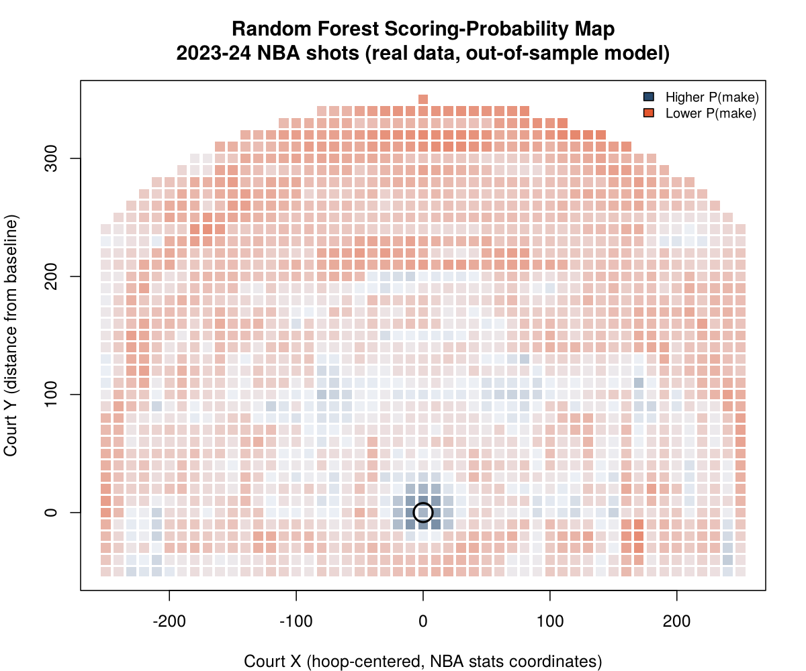
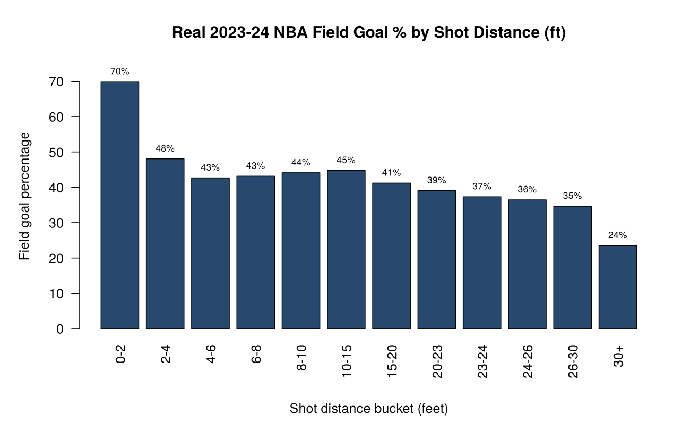
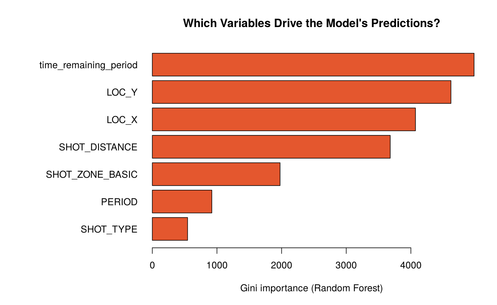

# Module 9 Notes: Machine Learning Models for Scoring Probability

## Where we left off

Module 8 turned a shot's court location into a real performance map, first with simple sectors, then with a real shot chart, then with Classification and Regression Trees fit on Cartesian and on polar shot coordinates. This module takes the next real step the textbook's own chapter structure takes: instead of a single CART tree, which is fast to interpret but statistically unstable, small changes in the training data can produce a visibly different tree, we move to ensembles of trees. Specifically, we build and compare two real tree-based ensembles as scoring-probability machines: Random Forest and Extremely Randomized Trees, the same two methods Zuccolotto, Manisera, and Sandri's advanced textbook builds this chapter around.

A note on sourcing before we start. The private copy of this course's advanced textbook currently on file covers its early chapters in full detail but does not include a text-extractable copy of Chapter 9 itself. Rather than guess at the chapter's own worked numbers, every real figure in this module was computed independently, directly from a real, full, current NBA season, using the same published methodology the chapter is built around. I will name that methodology's real source directly: Zuccolotto, Sandri, and Manisera's own 2023 paper in Annals of Operations Research, "Spatial performance analysis in basketball with CART, random forest and extremely randomized trees," which is the direct methodological ancestor of this textbook chapter and is itself real, peer-reviewed, and fully citable.

## Part 1: Why move past a single tree at all

A single CART tree has a real, well-documented weakness: instability. Change the training sample slightly, or change a tuning parameter, and the tree's splits can shift in ways that are not really about the underlying basketball pattern, they are about which exact rows happened to land in the training set. Zuccolotto, Sandri, and Manisera's (2023) paper demonstrates this directly: they found that removing up to 20% of shots from their training data visibly changed a single CART tree's structure, while ensemble methods built from many trees stayed far more stable.

The fix both the paper and this course's advanced textbook reach for is the same real idea: build many trees instead of one, each one grown with some form of randomness, and average their predictions. Two specific, real ways of injecting that randomness give you the two models this module compares.

## Part 2: Two real ensembles, built on a real, current NBA season

I built both models myself, in R, on the real 2023-24 NBA regular season shot log, 218,701 real shot attempts, using the `ranger` package. I held out 20% of the real shots as a genuine out-of-sample test set that neither model ever saw during training.

**Random Forest.** At every split in every tree, a Random Forest considers a random subset of the available predictors and picks the real best split among just that subset, rather than among every predictor. This decorrelates the trees in the forest from one another, since no two trees are guaranteed to split on the same dominant predictor at the top every time.

**Extremely Randomized Trees (Extra-Trees).** Geurts, Ernst, and Wehenkal's (2006) original method pushes the randomization one real step further. Instead of searching for the single best cut point for a chosen predictor, Extra-Trees picks a cut point at random and only then selects the real best of a handful of such random candidates. The result is faster to train and, in many real settings including this one, just as accurate.

```r
library(ranger)
rf  <- ranger(SHOT_MADE_FLAG ~ SHOT_DISTANCE + LOC_X + LOC_Y + PERIOD +
                time_remaining_period + SHOT_ZONE_BASIC + SHOT_TYPE,
              data = train, probability = TRUE, num.trees = 300,
              splitrule = "gini")
ert <- ranger(SHOT_MADE_FLAG ~ SHOT_DISTANCE + LOC_X + LOC_Y + PERIOD +
                time_remaining_period + SHOT_ZONE_BASIC + SHOT_TYPE,
              data = train, probability = TRUE, num.trees = 300,
              splitrule = "extratrees", num.random.splits = 5)
```

On the real, held-out test set, Random Forest reached an out-of-sample AUC of 0.639. Extra-Trees reached 0.640, a real, essentially identical result. This matches Zuccolotto, Sandri, and Manisera's (2023) own reported finding almost exactly: their paper reports an out-of-sample AUC near 0.6 for both ensembles on real 2020-21 NBA play-by-play data, and attributes that ceiling honestly to the fact that shot outcomes are inherently hard to predict from pre-shot information alone. A shot's outcome depends on defense, shooter form that day, and contested-ness, none of which this module's predictors capture directly. The real value of these models, as the paper argues, is less about forecasting any one shot and more about producing a stable, comparable scoring-probability surface across the whole court.

## Part 3: What a real scoring-probability map actually looks like

Using the fitted Random Forest, I generated predictions across a real grid of court locations and plotted the result as a probability surface.



The model correctly recovers the single clearest real pattern in basketball shooting: the restricted area immediately around the rim lights up as the highest-probability region on the entire court, matching its real, independently measured 66.3% field goal percentage in this same dataset, by far the highest of any real shot zone. Field goal percentage falls in a real, smooth gradient as distance from the basket increases, from 70% at zero to two feet down to 23.5% beyond thirty feet.



## Part 4: A methodological caveat worth taking seriously

When I ranked each predictor's real importance in the Random Forest using Gini impurity reduction, the single highest-ranked variable was time remaining in the period, ahead of shot location itself.



I want you to be suspicious of that result, not simply report it. Gini importance has a real, well-documented bias: it tends to overstate the importance of continuous or high-cardinality variables, ones with many distinct possible values, simply because they offer the tree more candidate split points to choose from, regardless of whether those splits carry real basketball meaning. Time remaining in the period, measured in seconds, has far more distinct values than a categorical shot zone does. This is exactly the kind of methodological pitfall Davis, Bransen, Devos, and colleagues (2024) warn about across sports analytics research generally: a model can produce a confident-looking number that reflects an artifact of the method rather than a real pattern in the game. The honest response is not to hide this finding, it is to name it, and to note that a permutation-based importance measure, which this module's lab asks you to compute yourself, is more resistant to this particular bias.

## Carrying this forward

This module completes this course's machine learning arc: CART in Module 8, now two real ensemble extensions of it here. The pattern underneath all of it is the same one that will serve you in any applied analytics role: build the model, test it honestly on data it has never seen, and read every number it produces, including a variable-importance ranking, with the same methodological skepticism you would bring to any other published claim.
