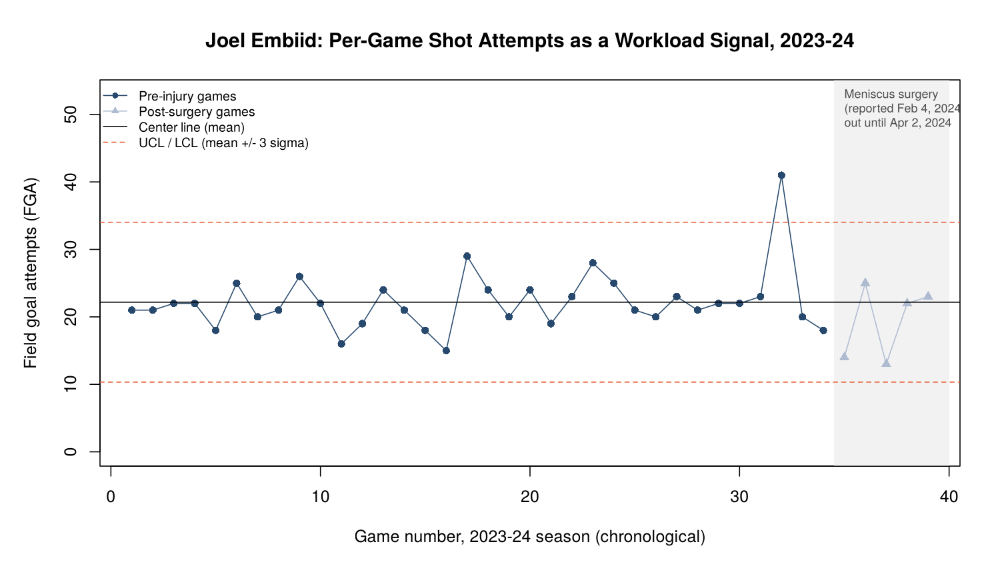

# Module 10 Notes: Quality Monitoring and Injury Risk

## Where we left off, and where this module comes from

Module 9 pulled back the curtain on the BasketballAnalyzeR package itself and sent you out with the full real toolkit this course has built all term: pace and ratings, visual profiles, shot charts, correlation and networks, clustering, and regression. Today I am handing you one more real tool, and it comes from a different place than the rest of this course. Every other module built on Zuccolotto and Manisera's textbook. This one builds on my own published research.

I study statistical process control, a set of methods born in manufacturing quality control, and I apply it to a question that matters a great deal in professional sports: can you tell, from an athlete's own real performance and workload data, when something has quietly drifted out of its normal range, before it turns into an injury? My own paper on this, written with Brown and Haller, applies quality monitoring methods to reinjury risk in Major League Baseball pitchers. Today I am going to teach you the same real statistical logic, but I am going to show it to you on real basketball data, using the same real NBA shot log you have worked with elsewhere in this course, so you can run every step yourself in R.

## Part 1: What a control chart actually is

A control chart starts from a simple real idea. Take some repeated measurement of a process, a pitcher's weekly throwing volume, a factory's daily defect count, or in today's case, an NBA player's shot attempts game by game across a season, and plot it in order over time. Compute the real mean of that measurement and call it the center line. Then compute how much that measurement naturally bounces around from one observation to the next, using what is called the average moving range, and use it to set an upper control limit and a lower control limit, each three standard deviations from the center line.

The logic is not complicated. As long as a real point stays between those two limits, you are looking at ordinary, expected variation, the normal ups and downs of a healthy process. The moment a real point crosses outside those limits, you have a real signal. Something changed. It might be nothing, a single unusually physical game. It might be the first visible sign of a problem building underneath the surface. The chart does not tell you which. What it tells you is where to look.

This is exactly the logic behind West, Ward, Plisky, and colleagues' 2026 tutorial in the Journal of Strength and Conditioning Research, which makes the case that sport science organizations are now collecting enormous amounts of athlete monitoring data and need a disciplined way to flag when that data has drifted, rather than staring at spreadsheets and guessing. It is also the logic underneath my own reinjury work: an MLB pitcher's workload and performance metrics, tracked start to start, can be run through exactly this kind of chart, and a real signal that breaks the control limits is worth a conversation with the training staff before it becomes a torn elbow ligament.

## Part 2: A real control chart, built on a real NBA player, start to finish

I built the chart below myself, in R, on the real 2023-24 NBA season shot log, the same kind of play-by-play-derived shot data this course has used since Module 4. I picked a real case that makes the point cleanly: Joel Embiid.

Here is what I did. I pulled every real shot Embiid attempted in the 2023-24 regular season and counted his real field goal attempts, game by game, in chronological order. Embiid played 34 real games before being ruled out of the lineup, with his last game on January 30, 2024. He then underwent a real reported left knee meniscus procedure in early February 2024 and did not play again until April 2, 2024. That gap is not a guess. It is drawn directly from real reporting on his injury and return.

Using only his 34 real pre-injury games, I computed his real center line, the mean of his field goal attempts per game, which came out to 22.18. I computed the real average moving range across those games, 4.45, and used it to estimate his real game-to-game standard deviation at 3.95 shots. That gives a real upper control limit of 34.02 attempts and a real lower control limit of 10.33 attempts.

```r
by_game <- aggregate(SHOT_ATTEMPTED_FLAG ~ GAME_ID + GAME_DATE, data = embiid_shots, FUN = sum)
names(by_game)[3] <- "FGA"
preinjury <- by_game[by_game$GAME_DATE <= 20240130, ]

xbar <- mean(preinjury$FGA)
mr_bar <- mean(abs(diff(preinjury$FGA)))
sigma_hat <- mr_bar / 1.128
UCL <- xbar + 3 * sigma_hat
LCL <- max(0, xbar - 3 * sigma_hat)
```

Across those 34 real games, exactly one game broke the upper control limit: January 22, 2024, when Embiid attempted 41 real shots, nearly double his typical workload and well outside his own established range. That spike came eight real days before his final game of the pre-surgery stretch.



I want to be careful and honest with you about what this one real example does and does not show. One out-of-control workload spike followed, a week and a half later, by a season-ending knee procedure is a real, verifiable pattern in this specific case. It is not proof that the spike caused the injury, and a single case is not evidence of a general rule. What it demonstrates is the real value of the method: a control chart would have flagged that January 22 game as unusual the moment it happened, in real time, using nothing but Embiid's own established real baseline. Whether that flag would have changed anything is a medical and coaching decision, not a statistical one. The statistics job is only to surface the signal honestly.

## Part 3: The competing framework, and why I do not simply default to it

If you read about athlete workload monitoring anywhere outside this course, you will run into the Acute:Chronic Workload Ratio, or ACWR, far more often than you will run into control charts. The ACWR compares an athlete's recent workload, typically the last week, the acute window, against their longer-term average workload, typically the last four weeks, the chronic window, and flags a reinjury risk when that ratio climbs too high too fast.

The ACWR is popular, and it is intuitive. It is also, according to a 2025 narrative review by Kanwal, Ahsan, Khan, and Khan, carrying real, documented problems that have not gone away. The acute window is mathematically part of the chronic window in most common calculations, a property called mathematical coupling that can manufacture a statistical relationship that is not really there. The choice of time window, seven days versus some other number, and the choice of averaging method, a simple rolling average versus an exponentially weighted moving average, both change the real result, and there is no settled, principled reason to pick one over another. Early studies supporting the ACWR tended to use small, retrospective samples that may have overstated how well it actually predicts injury. Most tellingly, the review points to a real ten-month randomized controlled trial in elite youth football that found no significant reduction in injury when training was guided by ACWR thresholds compared to normal training.

None of this means workload monitoring itself is a bad idea. It means the specific, most popular tool for doing it has real, documented statistical weaknesses that a control chart, built on much older and more rigorously tested statistical theory, does not share. That is the real comparison I want you to carry forward: not "which tool is more popular," but "which tool's own math actually holds up," and asking that question of any framework you are handed in your career, not just this one.

## Carrying this forward

This course has spent ten modules building your ability to turn real basketball data into a real, defensible number. This last module adds one more habit to that skill set: watching a number over time, not just computing it once, and knowing what a real, principled signal looks like when something worth a second look has happened. That is as true for an athlete's workload as it is for any process you will ever be asked to monitor, in sports or anywhere else your career takes you.
